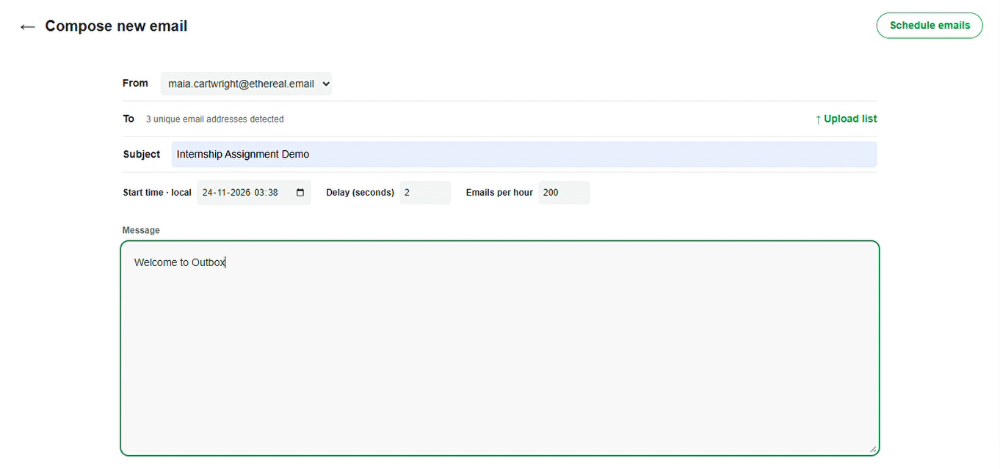

# Email Job Scheduler

Upload a CSV or text file, choose a sender, and schedule a campaign. The worker enforces sender and campaign limits across restarts. Ethereal captures messages for preview. The dashboard shows scheduled emails and the outcome of each delivery attempt.


## Stack

React, TypeScript, Vite and Tailwind CSS on the client. Express stores campaigns, sessions and delivery state in PostgreSQL. A separate BullMQ worker reads pending events from PostgreSQL, queues deliveries in Redis, sends mail through Nodemailer and indexes messages in Elasticsearch. Google handles sign-in. Slack can notify a channel when an hourly limit is reached.

## Assignment features

| Area | Implementation |
| --- | --- |
| Scheduling | An authenticated campaign API accepts the start time, interval, hourly limit and sender. A request key makes a retried submission idempotent. |
| Delivery | BullMQ delayed jobs, multiple Ethereal mailboxes, configurable worker concurrency and PostgreSQL rate counters. |
| Search and operations | Elasticsearch indexes recipients, subjects and bodies. The read-only Bull Board at `/ops/queues` shows queue state to the configured administrator. |
| Slack | Each account can connect a channel through OAuth. The worker queues a webhook notification when the last hourly slot is consumed. Disconnecting disables alerts. |
| Dashboard | Google sign-in, profile and logout, CSV/text upload with a unique-recipient count, scheduling controls, searchable scheduled and sent tables, loading and empty states. |

## How scheduling works

1. The API writes the campaign, one email per unique recipient and pending queue/index events in a single PostgreSQL transaction. Each recipient gets a due time based on its position in the upload.
2. The worker relays pending events into Redis using the email ID as the BullMQ job ID. A restart can replay a pending event against that same ID. Keep PostgreSQL and Redis data on persistent storage and enable Redis persistence.
3. Before SMTP, a worker takes a PostgreSQL advisory lock for that sender. It checks the sender and campaign counters for the current UTC hour and the earliest permitted send time. The defaults are a two-second cooldown and 200 attempts per sender per hour. Different senders can progress in parallel. When either budget is exhausted, BullMQ delays the job until both budgets allow it.
4. For a burst of 1,000 emails, eligible jobs consume the available slots and the rest stay scheduled. The upload order determines initial due times. Lock contention and retries can change the order of jobs due together.

**Delivery trade-offs.** If a worker stops during SMTP, the next worker marks the attempt `uncertain` because the provider may already have accepted it. Check the Ethereal mailbox before resending manually. Search and Slack use retryable events, so they may lag delivery. A Slack retry can repeat a notification if the first response was lost.

## Setup

1. Install Node.js 22.13 or newer. Start PostgreSQL, Redis 7 and Elasticsearch 8. Create an empty database named `email_scheduler` and grant the configured user permission to create tables in it.
2. Run the commands below from the project root. The setup command creates a private `.env` in the project root with a generated app key and a suggested local database password. It preserves an existing `.env`.
3. Set the password on your PostgreSQL role to match `POSTGRES_PASSWORD`, or edit that field to match your existing database. Then create a test mailbox at <https://ethereal.email/create> and put its address and password into `SMTP_SENDERS`. Add another entry with a different ID and mailbox to schedule from a second sender. Register a Google web OAuth client with redirect URI `http://localhost:3000/auth/google/callback` and enter its credentials.

```sh
npm ci
npm run setup:env
```

| Setting | Purpose |
| --- | --- |
| `APP_URL`, `PORT` | Public browser origin and API listen port. Defaults to `http://localhost:3000` and `3000`. With no explicit origin, Render can supply `RENDER_EXTERNAL_URL`. |
| `APP_KEY` | Stable 64-character hex key for OAuth state and stored Slack webhooks. Use the same key for both processes. |
| `PGHOST`, `PGPORT`, `PGUSER`, `PGDATABASE`, `POSTGRES_PASSWORD` | PostgreSQL connection. For hosted TLS, set `PGSSLMODE=require` or `PGSSL=true`. |
| `REDIS_HOST`, `REDIS_PORT` | Redis connection. Optional credentials are `REDIS_USER` and `REDIS_PASSWORD`. Use `REDIS_TLS=true` for TLS. |
| `ES_URL` | Elasticsearch endpoint. For authentication use `ES_API_KEY`, `ES_USERNAME` and `ES_PASSWORD` together, or `ES_AUTH` for an authorization header. |
| `GOOGLE_CLIENT_ID`, `GOOGLE_CLIENT_SECRET` | Google sign-in credentials. |
| `SMTP_SENDERS` | JSON array of senders. Each requires a unique `id`, an Ethereal email address in `user`, and its password in `pass`. |
| `MIN_DELAY_MS`, `MAX_EMAILS_PER_HOUR`, `WORKER_CONCURRENCY` | Default sender cooldown (2,000 ms), hourly limit (200) and concurrency per worker (8). |
| `QUEUE_ADMIN_EMAIL` | Optional Google account with access to the read-only queue dashboard at `/ops/queues`. |
| `SLACK_CLIENT_ID`, `SLACK_CLIENT_SECRET` | Optional Slack app credentials. Enable incoming webhooks and register `<APP_URL>/auth/slack/callback` on an HTTPS origin. |

## Run

```sh
npm run build
npm start
```

In another terminal, run `npm run worker` from the same directory. Open <http://localhost:3000>. Both processes read `.env` and apply the schema on startup.

For hot reload, run `npm run web` in a third terminal. Set `APP_URL=http://localhost:5173`, register the Google callback on that origin, and restart the API. Vite proxies requests to the API on port 3000.

Run the unit tests with `npm test`. The integration suite needs an empty database named `reachinbox_integration`, fresh dedicated Redis and Elasticsearch instances, and ports 3000, 3250 and 2525 free. Set the connection variables in the test shell, then run `npm run test:integration`. The suite supplies local Google, Slack and SMTP fixtures.



## Demo

[Watch the dashboard walkthrough](docs/demo/scheduler-walkthrough.mp4). This excerpt from the original recording shows a recipient upload, campaign creation and the Scheduled and Sent tables using a demo profile. Live Google sign-in, a server restart and Slack channel receipt still need to be recorded for the hiring submission.

## Layout

```text
backend/src/        Express API and BullMQ worker entry points
  routes/           Google and Slack OAuth, campaigns and email lists
  services/         Queue, rate-limit policy, event relay, search and Slack
  db/               PostgreSQL connection, transactions and schema
frontend/src/       React entry point and styles
  components/       Dashboard branding, campaign composer and email table
  services/         Typed API client
  utils/            CSV and text recipient parsing
tests/              Parser and rate-limit unit tests
  integration/      Scheduler integration test and provider fixtures
docs/demo/          Dashboard walkthrough
docs/screenshots/   Scheduled emails and composer
```
