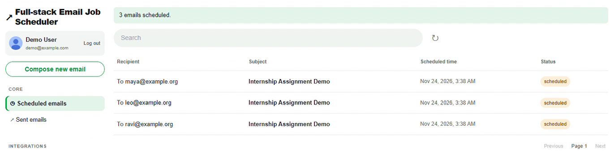
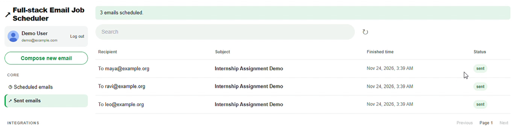
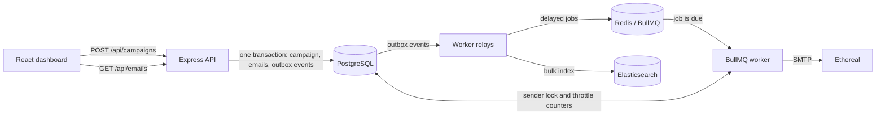

<div align="center">

# 📬 Full-stack Email Job Scheduler

**Upload a list of leads, pick a start time, and let the queue send the emails for you.**
Scheduled sends survive restarts, and per-sender rate limits keep the SMTP side under control.


</div>

---

## 📑 Table of contents

- [✨ Overview](#-overview)
- [🧰 Tech stack](#-tech-stack)
- [📁 Project structure](#-project-structure)
- [🧱 Architecture](#-architecture)
- [✅ Features](#-features)
- [🚀 Getting started](#-getting-started)
- [🔌 API reference](#-api-reference)
- [🎬 Demo video](#-demo-video)
- [🧪 Tests](#-tests)
- [📝 Assumptions, shortcuts and trade-offs](#-assumptions-shortcuts-and-trade-offs)
- [🩺 Troubleshooting](#-troubleshooting)

---

## ✨ Overview

You sign in with Google, upload a CSV or text file of email addresses, write one subject and message, and choose when sending starts, how many seconds to leave between emails, and a cap on emails per hour. Each unique address becomes its own scheduled email.

A few things this project cares about:

- ⏰ **Real delayed jobs.** Timing is handled by BullMQ delayed jobs in Redis. There is no cron job scanning the table.
- 💾 **Restart-safe.** PostgreSQL holds the truth, Redis persists to disk, and an outbox makes sure nothing is lost between the two.
- 🚦 **Rate limited.** Hourly caps and minimum gaps are enforced per sender and per campaign, across any number of worker processes.
- 🔁 **No double sends.** Stable job IDs, idempotent campaign creation and a per-sender lock keep duplicates out.

Emails go out through [Ethereal](https://ethereal.email), a fake SMTP service that captures messages instead of delivering them, so you can test freely.

<table>
  <tr>
    <td></td>
    <td></td>
  </tr>
  <tr>
    <td align="center"><sub>Scheduled tab</sub></td>
    <td align="center"><sub>Sent tab</sub></td>
  </tr>
</table>

---

## 🧰 Tech stack

| Layer | Technology |
| --- | --- |
| 🖥️ **Frontend** | React 19, TypeScript, Vite 6, Tailwind CSS 3 |
| ⚙️ **Backend** | Node.js 22, Express 5, TypeScript (run with `tsx`), Zod for validation |
| 📮 **Queue / scheduler** | BullMQ 5 on Redis 7.4 (AOF persistence) |
| 🗄️ **Database** | PostgreSQL 16 |
| 🔎 **Search** | Elasticsearch 8.17 (dashboard search box) |
| ✉️ **Email** | Nodemailer over Ethereal SMTP (`smtp.ethereal.email:587`, STARTTLS) |
| 🔐 **Auth** | Google OAuth 2.0, opaque cookie sessions |
| 🔔 **Notifications** | Slack incoming webhooks (optional) |
| 📊 **Queue dashboard** | Bull Board, read-only, admin only |
| 🐳 **Infra** | Docker and Docker Compose |
| 🧪 **Testing** | Node's built-in test runner, `smtp-server` for a fake SMTP receiver |

---

## 📁 Project structure

```text
.
├── backend/
│   └── src/
│       ├── api.ts              # Express app: auth, /api routes, Bull Board, serves the React build
│       ├── auth.ts             # Google + Slack OAuth, sessions, logout
│       ├── core.ts             # Env validation, Postgres pool, BullMQ queue, encryption, migrations
│       ├── policy.ts           # Pure rate-limit window maths (unit tested)
│       ├── relay.ts            # Outbox consumers: enqueue, index and notify
│       ├── worker.ts           # BullMQ worker: throttle -> SMTP -> status update
│       ├── schema.sql          # Postgres schema, applied automatically on start
│       ├── routes/
│       │   ├── campaigns.ts    # POST /api/campaigns (idempotent intake)
│       │   └── emails.ts       # GET /api/emails (tabs, search, pagination)
│       └── services/
│           ├── search.ts       # Elasticsearch mapping and bulk indexing
│           └── slack.ts        # Slack webhook delivery
├── frontend/
│   ├── index.html
│   ├── vite.config.ts          # Dev proxy for /api, /auth and /ops
│   └── src/
│       ├── main.tsx            # App shell: login, sidebar, routing between views
│       ├── api.ts              # Typed fetch wrapper
│       ├── leads.ts            # Email extraction from CSV/text
│       ├── style.css
│       └── components/
│           ├── Brand.tsx
│           ├── Compose.tsx     # Compose and schedule form
│           └── EmailTable.tsx  # Scheduled / Sent table with search and paging
├── tests/
│   ├── policy.test.ts          # Unit: rate windows and cooldowns
│   ├── leads.test.ts           # Unit: lead parsing
│   └── integration/            # End-to-end suite with two workers and fake providers
├── demo/Scheduler-Demo.mp4     # Restart + rate-limit demo
├── docs/screenshots/           # Images used in this README
├── compose.yaml                # App stack: db, redis, search, api, worker
├── compose.test.yaml           # Isolated stack for integration tests
├── Dockerfile
├── .env.example
├── leads.demo.csv              # Sample recipient list
└── package.json
```

---

## 🧱 Architecture



### ⏰ How scheduling works

1. The Compose form sends `POST /api/campaigns` with an `Idempotency-Key` header.
2. In **one database transaction**, the API writes the campaign, one `email` row per unique address, and two outbox events per email (`enqueue` and `index`). Each email's due time is `start + position × delay`.
3. A relay loop inside the worker process picks up committed events (`FOR UPDATE SKIP LOCKED`) and adds them to the `delivery` queue in batches of up to 100. Each BullMQ job uses the **email's UUID as its job ID** and a `delay` equal to the time left until it is due. The job payload only carries that ID.
4. When a job becomes due, a worker loads the email from Postgres, goes through the rate limiter (below), sends via Nodemailer, and records the result.

Email status moves through `scheduled → sending → sent`, or ends in `failed` or `uncertain`.

> No timers are created per recipient in memory, and nothing polls the table for due emails. BullMQ owns the timing.

### 💾 How persistence on restart is handled

| Situation | What happens |
| --- | --- |
| Server or worker is stopped and started again | Campaigns, emails and counters are in Postgres. Delayed jobs are in Redis, which runs with `appendonly yes` and `appendfsync always` on a named volume. When workers come back, anything that came due in the meantime is picked up straight away (still rate limited). |
| Crash after the DB commit but before the job reached Redis | The outbox event is still in Postgres, so the relay replays it on the next start. |
| Crash after the job reached Redis but before the event was marked done | The event is replayed with the same job ID, so BullMQ does not create a duplicate. |
| Worker dies in the middle of an SMTP call | BullMQ's stalled-job recovery hands the job to another worker. Because the email was already marked `sending`, it is set to `uncertain` and **not** sent again. |

### 🚦 How rate limiting and concurrency are implemented

**Rate limiting**

- Three limits apply: a **per-sender hourly cap** (`MAX_EMAILS_PER_HOUR`), a **per-campaign hourly cap** (the "Emails per hour" field), and a **minimum delay between sends** for both the sender (`MIN_DELAY_MS`) and the campaign ("Delay" field).
- Hours are fixed UTC windows. Counters live in the `throttle` table, keyed `sender/<id>` and `campaign/<uuid>`, each with the window, the count used and the next allowed time.
- Before sending, the worker works out the earliest allowed time: the latest of the email's own due time, both cooldowns, and the start of the next hour if a cap is full.
- If that time is in the future, the worker saves the new due time and moves the job back into BullMQ's delayed set, then frees its slot. **Nothing is dropped and nothing sleeps.** The remaining emails simply go out in the next window.
- Every attempt, including failed or uncertain ones, uses up quota. The cooldown is measured from when the SMTP call finished.
- When the last slot in a window is used, an optional Slack alert is queued.

**Concurrency**

- Each worker process runs up to `WORKER_CONCURRENCY` jobs at once (default 8, max 24). You can run more worker processes with `docker compose up -d --scale worker=2`.
- Different senders send in parallel. **One sender is serialized** by a Postgres advisory lock held through the SMTP call, so two workers can never send from the same mailbox at once. If a job finds the lock taken, it retries after a short random delay.
- The counters are updated and the email is marked `sending` in a single transaction while the lock is held. The SMTP call itself runs outside the transaction.

---

## ✅ Features

### ⚙️ Backend

| Requirement | What was built |
| --- | --- |
| ⏰ **Scheduler** | BullMQ delayed jobs, one per recipient, spaced by the chosen delay. Transactional outbox moves work from Postgres into Redis. |
| 💾 **Persistence** | Postgres for campaigns, emails, counters and outbox. Redis with AOF `always`. Replayable events, stable job IDs and stalled-job recovery. |
| 🚦 **Rate limiting** | Per-sender and per-campaign hourly caps, minimum gap between sends, delayed rather than dropped when full. |
| 🧵 **Concurrency** | Configurable concurrency per worker, multiple workers supported, per-sender advisory lock, cross-worker counters. |
| 🔁 **Idempotency** | UUID `Idempotency-Key` on campaign creation. A retry returns the same campaign, and reusing a key with a different body returns `409`. |
| 🔐 **Auth** | Google OAuth login, 7-day opaque sessions stored hashed, CSRF-style origin check on writes. |
| 🔎 **Search** | Elasticsearch index kept in sync through the outbox, with owner filters re-checked in Postgres. |
| 🔔 **Notifications** | Slack OAuth with the webhook URL encrypted at rest (AES-256-GCM), alert when a limit is reached. |
| 📊 **Ops** | Read-only Bull Board at `/ops/queues` for one admin email. |

### 🖥️ Frontend

| Area | What it does |
| --- | --- |
| 🔑 **Login** | "Login with Google" page, sign-in cancelled message, logout. |
| 🏠 **Dashboard** | Sidebar with profile, **Scheduled emails** and **Sent emails** views, success banner after scheduling. |
| ✍️ **Compose** | Sender dropdown, recipient upload (`.csv` or `.txt`, duplicates removed, count shown), subject, start time, delay in seconds, emails per hour, message body. |
| 📋 **Tables** | Recipient, subject, scheduled or finished time, and a coloured status badge. 25 rows per page with Previous and Next. |
| 🔍 **Search and refresh** | Search by recipient, subject or body. Auto-refresh every 5 seconds plus a manual refresh button. |
| 💬 **States** | Loading, empty and error states with a Retry button. |
| 👀 **Previews** | Sent subjects link to the Ethereal message preview. |
| 🔌 **Integrations** | Connect or disconnect Slack. Admins also see a link to the queue dashboard. |

---

## 🚀 Getting started

### 📋 Prerequisites

- **Docker** with Compose v2. Give Docker at least **4 GB** of memory, because Elasticsearch needs it.
- A **Google Cloud** account (for the OAuth client) and a free **Ethereal** account (for SMTP).
- Only if you run without Docker: **Node.js 22.18+ or 24**, plus your own Postgres 16, Redis 7 and Elasticsearch 8.

### 1️⃣ Clone and create your `.env`

```sh
git clone <your-repo-url>
cd <your-repo-folder>
cp .env.example .env
```

On Windows PowerShell use `Copy-Item .env.example .env`.

Generate the `APP_KEY` (64 hex characters) and paste it into `.env`:

```sh
openssl rand -hex 32
# or, if you don't have OpenSSL:
node -e "console.log(require('node:crypto').randomBytes(32).toString('hex'))"
```

### 2️⃣ Set up Ethereal (SMTP)

1. Open <https://ethereal.email/create> and click **Create Ethereal Account**.
2. Copy the generated **username** (it looks like `name@ethereal.email`) and **password**.
3. Create a **second** account the same way. One is enough to run the app, but two let you see senders working in parallel.
4. Put both in `SMTP_SENDERS` as JSON on a **single line**. The `id` is the name used internally, so keep ids unique and use only letters, numbers, `_` and `-`:

   ```env
   SMTP_SENDERS=[{"id":"research","user":"first@ethereal.email","pass":"PASSWORD_1"},{"id":"outreach","user":"second@ethereal.email","pass":"PASSWORD_2"}]
   ```

The app connects to `smtp.ethereal.email` on port 587 with STARTTLS. That host is set in `backend/src/worker.ts`, so there is nothing else to configure.

📥 **Where to see the emails:** Ethereal never delivers to real inboxes. Open the **Sent emails** tab and click a subject to see the captured message, or sign in at <https://ethereal.email/login> with the account's username and password and open **Messages**.

### 3️⃣ Set up Google login

1. In [Google Cloud Console](https://console.cloud.google.com/) go to **APIs & Services → Credentials → Create credentials → OAuth client ID**.
2. Choose **Web application**.
3. Add this authorized redirect URI exactly: `http://localhost:3000/auth/google/callback`
4. On the OAuth consent screen, add your own Google account as a **test user**.
5. Copy the client ID and secret into `GOOGLE_CLIENT_ID` and `GOOGLE_CLIENT_SECRET`.

### 4️⃣ Environment variables

| Variable | Required | Description |
| --- | :---: | --- |
| `APP_URL` | ✅ | Browser-facing origin, e.g. `http://localhost:3000`. Use HTTPS if you host it. |
| `APP_KEY` | ✅ | 64 hex characters. Keep it stable across restarts. It signs OAuth state cookies and encrypts Slack webhook URLs. |
| `POSTGRES_PASSWORD` | ✅ | Local database password. Compose sets the host, user and database name. |
| `GOOGLE_CLIENT_ID` / `GOOGLE_CLIENT_SECRET` | ✅ | OAuth client from step 3. |
| `SMTP_SENDERS` | ✅ | One-line JSON array of Ethereal senders from step 2. |
| `QUEUE_ADMIN_EMAIL` | ➖ | The Google account allowed to open `/ops/queues`. Leave it empty and nobody can. |
| `SLACK_CLIENT_ID` / `SLACK_CLIENT_SECRET` | ➖ | Only needed for **Connect Slack**. See the note below. |
| `MIN_DELAY_MS` | ➖ | Minimum cooldown after each send, per sender. Default `2000`. |
| `MAX_EMAILS_PER_HOUR` | ➖ | Hourly cap per sender. Default `200`. A campaign can set a lower one. |
| `WORKER_CONCURRENCY` | ➖ | Jobs running at once per worker process. Default `8`, max `24`. |

Docker Compose also sets `PGHOST`, `PGUSER`, `PGDATABASE`, `REDIS_HOST` and `ES_URL` for the containers. You only need to set those yourself when running outside Compose.

<details>
<summary>💬 <b>Optional: Slack alerts</b></summary>

<br>

1. Create a Slack app and enable **Incoming Webhooks**.
2. Add the `incoming-webhook` scope and set the redirect URL to `<APP_URL>/auth/slack/callback`.
3. Slack requires an HTTPS redirect, so use a tunnel (such as ngrok) or an HTTPS deployment. Set `APP_URL` to that origin and register the Google callback for it too.
4. Fill in `SLACK_CLIENT_ID` and `SLACK_CLIENT_SECRET`, sign in, click **Connect Slack** and pick a channel.
5. To see an alert, schedule three leads with an hourly cap of 2. The second email uses the last slot and triggers the message.

</details>

### 5️⃣ Run the backend (Express, Redis, Postgres, BullMQ worker)

#### 🐳 With Docker (recommended)

```sh
docker compose up --build -d
docker compose logs -f api worker
```

This starts everything:

| Service | What it is |
| --- | --- |
| `db` | PostgreSQL 16 with a named volume |
| `redis` | Redis 7.4 with AOF persistence and a named volume |
| `search` | Elasticsearch 8.17, single node |
| `api` | Express API. Applies the schema on start, serves the built React app and the queue dashboard on <http://localhost:3000> |
| `worker` | BullMQ worker plus the outbox relays that move events into Redis and Elasticsearch |

Useful commands:

```sh
docker compose up -d --scale worker=2   # run two workers (keep sender and limit settings identical)
docker compose down                     # stop, keep your data
docker compose down -v                  # stop and delete all data
```

> ⚠️ The **worker must be running** for emails to be queued and sent. The API only writes to Postgres.

#### 🔧 Without Docker

Start your own Postgres, Redis and Elasticsearch first, then from the project root:

```sh
npm ci
npm run build                 # builds the React app into frontend/dist

# load .env into the shell (bash/zsh)
set -a && source .env && set +a

# point at your services if they are not on the defaults
export PGHOST=localhost PGUSER=scheduler PGDATABASE=scheduler
export REDIS_HOST=localhost ES_URL=http://localhost:9200

npm run api                   # terminal 1, listens on :3000
npm run worker                # terminal 2
```

Run both commands from the repository root, since the API serves `frontend/dist` relative to it.

### 6️⃣ Run the frontend

**Production build (default).** The Express server already serves the compiled React app. After step 5, open <http://localhost:3000>.

**Development with hot reload.**

```sh
npm run web      # Vite dev server on http://localhost:5173
```

Vite proxies `/api`, `/auth` and `/ops` to the backend on port 3000, so keep the backend running. For this mode, set `APP_URL=http://localhost:5173` in `.env`, restart the API, and add `http://localhost:5173/auth/google/callback` as a second redirect URI in Google Cloud.

### 7️⃣ Try it

1. Open the app and log in with Google.
2. Click **Compose new email**, upload `leads.demo.csv`, set the start time a minute ahead, and click **Schedule emails**.
3. Watch the rows in **Scheduled emails** move to **Sent emails**, then click a subject to open the Ethereal preview.

---

## 🔌 API reference

| Method and path | Purpose |
| --- | --- |
| `GET /auth/google` | Start Google login |
| `GET /auth/slack` | Start Slack connect (signed-in users only) |
| `POST /auth/logout` | End the session |
| `DELETE /auth/slack` | Remove the Slack connection |
| `GET /api/me` | Profile, sender list, limits and admin flag |
| `POST /api/campaigns` | Create a campaign. Needs an `Idempotency-Key` header (UUID). Returns `201` with the campaign ID and unique count, `200` if the same request is replayed, `409` if the key was used with a different body |
| `GET /api/emails?tab=scheduled&q=maya&page=1` | List up to 25 emails. Use `tab=sent` for finished ones |
| `GET /ops/queues` | Bull Board dashboard (admin only) |

**Limits:** up to 10,000 addresses per campaign, subject up to 250 characters on one line, body up to 100,000 characters, delay between `MIN_DELAY_MS` and one hour, hourly cap between 1 and `MAX_EMAILS_PER_HOUR`.

**Using Postman or cURL.** Log in through the browser, copy the `sid` cookie, and send it with your request:

```sh
curl -X POST http://localhost:3000/api/campaigns \
  -H "Content-Type: application/json" \
  -H "Idempotency-Key: $(uuidgen)" \
  -H "Cookie: sid=<your-session-cookie>" \
  -d '{
    "sender": "research",
    "subject": "Research update",
    "body": "Here is the update.",
    "leads": ["maya@example.org", "leo@example.org"],
    "start": "2026-12-01T10:00:00.000Z",
    "delay": 2000,
    "hourly": 2
  }'
```

`start` is an ISO date in UTC and `delay` is in milliseconds.

---

## 🎬 Demo video

<!--
  To make the video play inline on GitHub: edit this README on github.com, drag your .mp4 into the editor,
  and GitHub will insert a link that renders as a player. Otherwise, upload it to YouTube, Loom or Drive
  and replace the link below.
-->

▶️ **[Watch the demo (about 1.5 minutes)](ADD_YOUR_VIDEO_LINK_HERE)**

| Scenario | Where to see it |
| --- | --- |
| Creating scheduled emails from the frontend | Main demo video |
| Dashboard with **Scheduled** and **Sent** emails, plus Ethereal previews | Main demo video |
| Restart: stop everything, start again, future emails still send | [`demo/Scheduler-Demo.mp4`](demo/Scheduler-Demo.mp4) |
| Rate limiting: with a cap of 2 per hour, the third email moves to the next hour | [`demo/Scheduler-Demo.mp4`](demo/Scheduler-Demo.mp4) |

The recording in `demo/` was made from the integration setup, with a seeded test session and a local SMTP capture server standing in for Google and Ethereal.

**Reproduce the restart demo yourself:**

```sh
# 1. Compose a campaign with leads.demo.csv, start time 1 minute ahead, hourly cap 2
# 2. Before the due time, stop the app:
docker compose stop api worker
# 3. Start it again:
docker compose up -d --scale worker=2 api worker
# 4. Refresh the dashboard: same three rows, two get sent, the third waits for the next hour
```

---

## 🧪 Tests

```sh
npm ci
npm test            # unit tests: rate windows, cooldowns, lead parsing
npm run build       # TypeScript check + production React build
```

Integration suite (runs in its own throwaway Docker project):

```sh
docker compose -f compose.test.yaml up --build --abort-on-container-exit --exit-code-from integration
docker compose -f compose.test.yaml down
```

It runs the API with two worker processes against real Postgres, Redis and Elasticsearch, with a fake SMTP server and local stand-ins for Google and Slack. It covers concurrent idempotency, tenant isolation in search, restart recovery, hourly rollover, SMTP spacing, queue dashboard access, Slack disconnect and reconnect, 1,000 delayed jobs, and a worker being killed mid-SMTP (exactly one copy is received, and the email is marked `uncertain`).

---

## 📝 Assumptions, shortcuts and trade-offs

- **Shared sender pool.** Mailboxes come from `SMTP_SENDERS` and are managed by whoever runs the app. Users choose one in the Compose form but can't add their own. Each user only sees their own campaigns.
- **Ethereal only.** Emails are captured, never delivered. Messages are plain text, and one message is shared across the whole campaign (no per-recipient personalization).
- **Fixed hourly windows (UTC), not sliding ones.** A burst can land on both sides of an hour boundary, though the minimum gap still applies. Simple and cheap to reason about, but not perfectly smooth.
- **Due times are "not before" times.** Provider latency, downtime or rate limits can delay delivery. Strict ordering across jobs that become due at the same moment is best effort.
- **Duplicates are avoided over guaranteed delivery.** If a worker dies during SMTP, the email is marked `uncertain` instead of being retried. That can mean an undelivered email, so check the Ethereal mailbox and the `Message-ID` before resending by hand. Failed and uncertain attempts are not retried automatically and still count toward the hourly cap.
- **Search is eventually consistent.** Elasticsearch is updated through the outbox, so a new row can take a moment to be searchable. Browsing without a search term keeps working from Postgres if Elasticsearch is down. It is also the heaviest piece of the stack and arguably more than a project this size needs.
- **Lead parsing is simple.** The upload finds ordinary ASCII email addresses in any column or line, removes duplicates, and rejects files over 3 MB or lists over 10,000 addresses.
- **Slack is at-least-once.** A lost response can lead to a repeated alert, and Slack needs an HTTPS redirect URL, so local testing needs a tunnel.
- **Google sign-in only.** No email and password accounts.
- **Reference setup, not a hosted deployment.** The internal services aren't exposed outside Docker, and backups of the Postgres and Redis volumes are up to you. Losing both the volumes and the backups is outside what this setup recovers from.
- **Provider integrations in tests are fakes.** Google, Slack and SMTP are replaced with local stand-ins, so live consent screens, real Slack workspaces and Ethereal itself are only exercised by hand.

---

## 🩺 Troubleshooting

- **Emails stay on "scheduled" forever.** Check that the `worker` container is running (`docker compose ps`). It is the process that moves jobs into Redis and sends them.
- **Google says `redirect_uri_mismatch`.** The redirect URI in Google Cloud must match `APP_URL` exactly, including the port, plus `/auth/google/callback`.
- **A POST request is rejected with 403.** The request carried an `Origin` header that doesn't match `APP_URL`. This usually happens in Vite dev mode if `APP_URL` is still set to port 3000.
- **App won't start and says `Missing ...`.** A required variable in `.env` is empty. Check `APP_KEY`, `POSTGRES_PASSWORD` and `SMTP_SENDERS`.
- **Elasticsearch container keeps exiting.** Docker probably has too little memory. Raise it to 4 GB or more.
